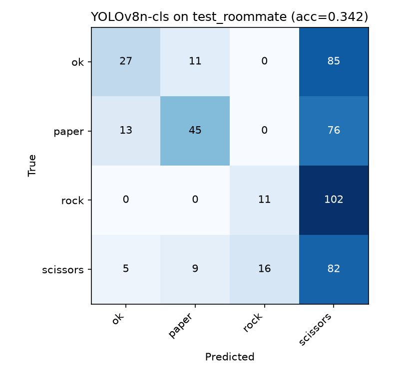
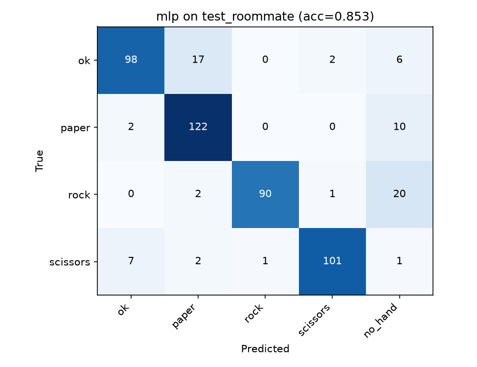
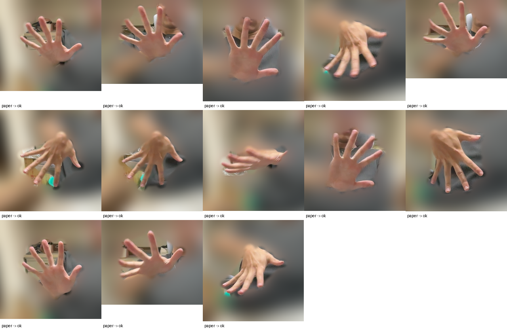
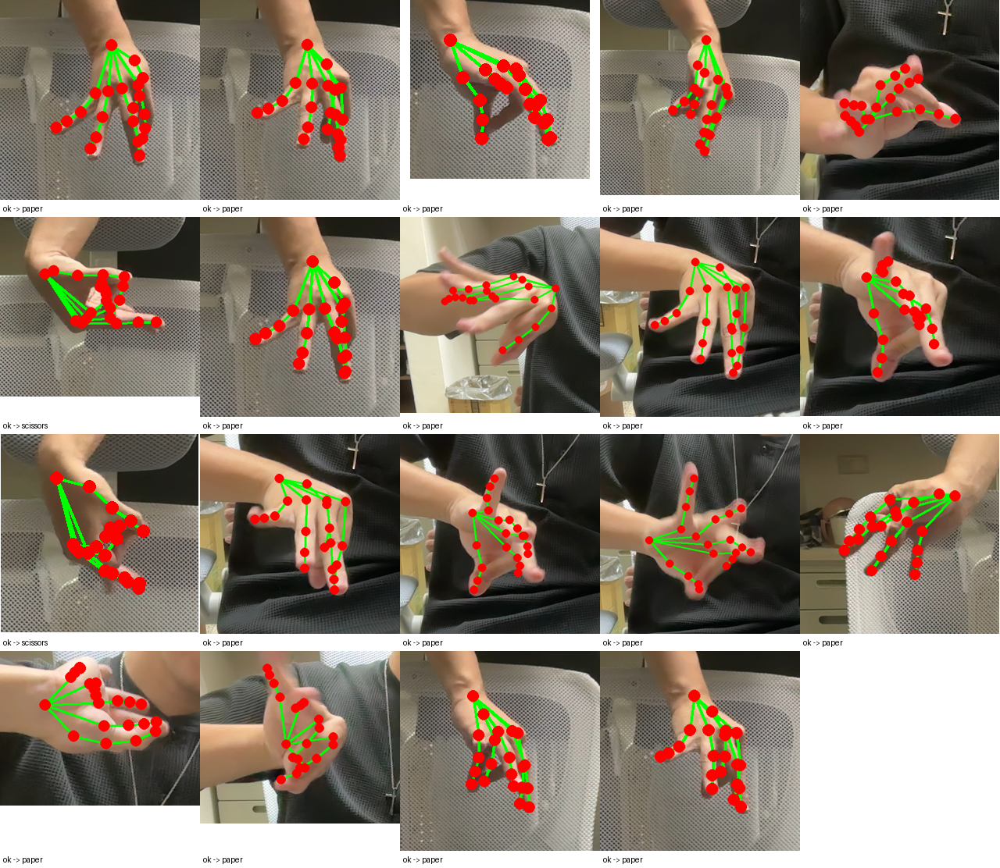
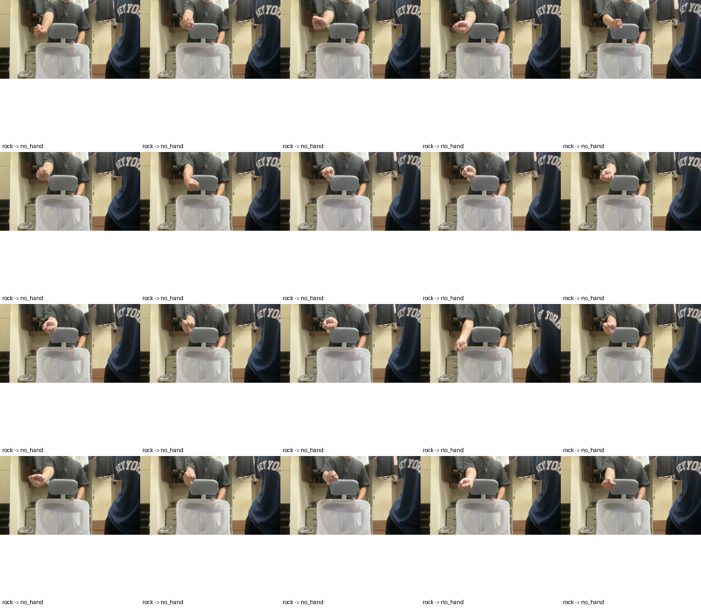
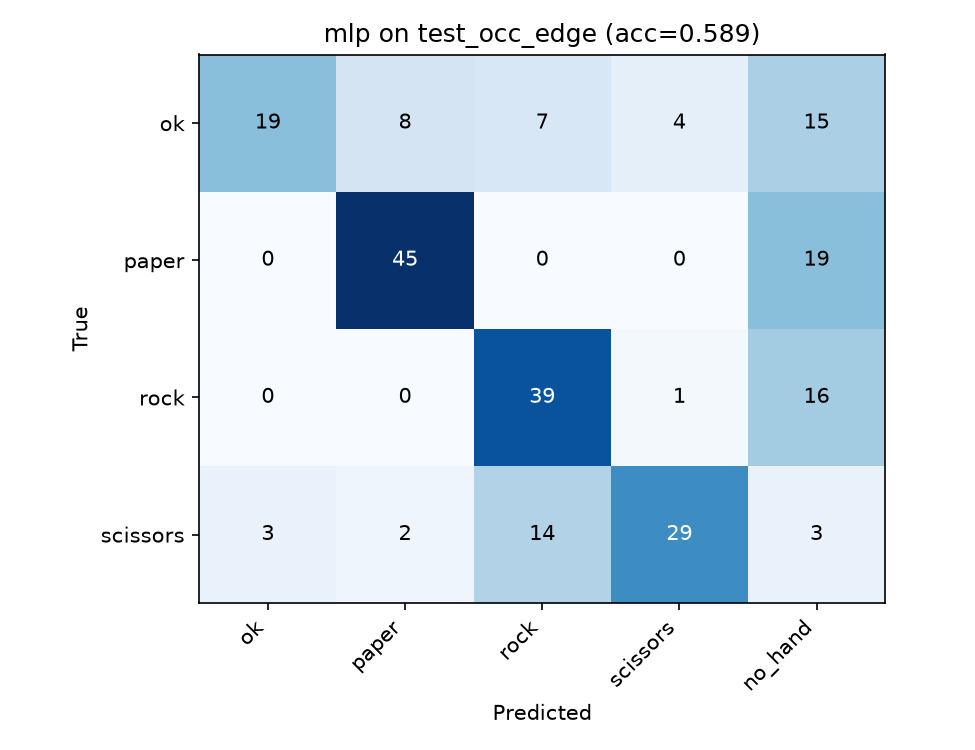
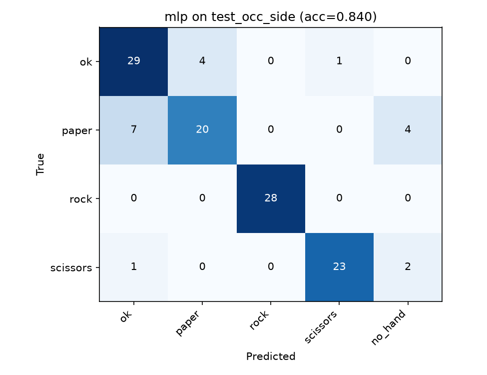
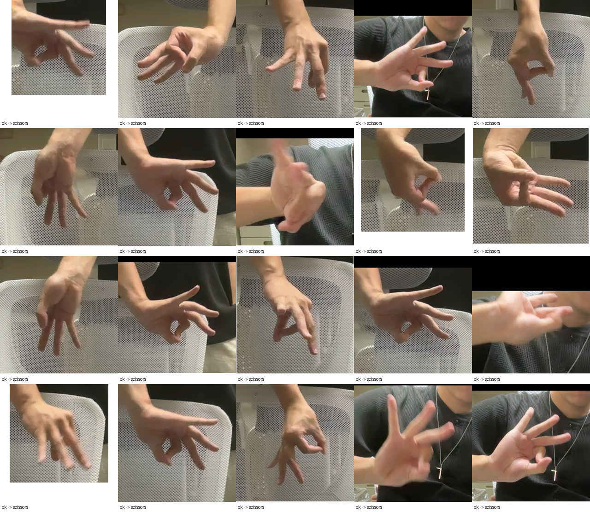

# 手勢辨識:YOLOv8n-cls 與 MediaPipe 關鍵點方法比較

辨識四種手勢(`ok`、`paper`、`rock`、`scissors`),比較兩種做法在「換一個人的手」、「暗光」、「雜亂背景」、「畫面邊緣」、「側面」下的表現。

**摘要結論:** 影像分類模型(YOLOv8n-cls)在驗證集約 0.68;換成室友的手之後,三次訓練平均只有 0.37 到 0.51(隨機猜測約 0.25),而且同一設定換隨機種子可以差 10 個百分點以上。先把手裁出來置中再分類,可以穩定提升到 0.55 到 0.73,但在原本三份室友測試集上仍落後「取出關鍵點再分類」的方法(0.80 到 0.89),手在畫面邊緣時會掉到 0.59。

Demo 影片尚未收錄;可用第 8 節的 `live_demo.py` 指令重現。

---

## 1. 目標

1. 用兩種方法做四類手勢分類:
   - **方法 A**:YOLOv8n-cls,直接吃整張影像。
   - **方法 B**:MediaPipe 取出 21 個手部關鍵點,再用小型分類器(隨機森林、MLP)分類。
2. 用一份「完全沒參與訓練、由另一個人拍攝」的測試集,檢查哪個方法能泛化到別人的手。
3. 記錄失敗案例,並嘗試解釋原因。

## 2. 資料

| 資料集 | 張數 | 每類張數(ok / paper / rock / scissors) | 說明 |
|---|---|---|---|
| train | 2014 | 504 / 505 / 503 / 502 | 我的手,8 種背景 |
| val | 463 | 106 / 106 / 106 / 145 | 我的手,2 種和 train 不同的背景 |
| test_roommate | 482 | 123 / 134 / 113 / 112 | **室友的手**,正常光線,多個場景 |
| test_dark | 225 | 55 / 54 / 54 / 62 | 室友的手,暗光 |
| test_cluttered | 225 | 58 / 57 / 55 / 55 | 室友的手,雜亂背景 |
| test_occ_edge | 224 | 53 / 64 / 56 / 51 | 室友的手,正常光,手在畫面邊緣 |
| test_occ_side | 119 | 34 / 31 / 28 / 26 | 室友的手,正常光,手側面(角度未記錄) |

- 這些室友測試集**只用來評估,沒有拿來訓練,也沒有用來調模型或參數**。
- 但請注意:第 5.3 節的邊緣/側面是後來補拍的,第 5.4 節的裁切實驗與多種子重複也是**看過測試結果之後才做的事後探索**。
- 平均亮度(0 為全黑,1 為全白):test_roommate 為 0.465,test_dark 為 0.194。
- 拍攝裝置:Mac 前置鏡頭;以右手為主;有使用螢幕顯示背景。
- `check_dataset.py` 目前只檢查 train、val、test_roommate;新拍的 edge/side 沒有跑。模糊警告很多,但目視後決定保留;沒有跨 split 重複。
- 資料集含個人照片,**不放在這個 repo 裡**。README 的失敗案例圖已裁切、模糊,或確認不含可辨識的人臉。

## 3. 方法

### 方法 A:YOLOv8n-cls

- 預訓練的 `yolov8n-cls` 微調,輸入 224×224,最多 20 個 epoch(early stopping,patience 8),在 Apple Silicon(`mps`)上訓練,權重由 val 準確率挑選(`best.pt`)。
- 訓練的版本:

| 版本 | 訓練資料 | augmentation | 訓練次數 |
|---|---|---|---|
| baseline | 早期資料:3 種背景、每類約 160 張 | 預設 | 1 次 |
| 整張圖(exp1) | 目前的 train(8 種背景) | 預設 | 3 次(種子 0、1、2) |
| exp2 | 同上 | 加強:色相 0.03、飽和度 0.8、亮度 0.6、旋轉 20°、縮放 0.7、左右翻轉 0.5、隨機遮擋 0.5 | 1 次 |
| 裁切 margin 0.3 | MediaPipe 偵測到的手,外框每邊外擴 30%,裁成正方形 | 預設 | 3 次 |
| 裁切 margin 1.0 | 同上,外擴 100%(保留較多背景) | 預設 | 3 次 |

### 方法 B:MediaPipe 關鍵點 + 小分類器

- MediaPipe Hand Landmarker 偵測一隻手,取得 21 個關鍵點。
- 特徵(共 78 維):
  - 以手腕為原點,用「手腕到中指根部」的長度做縮放後的 63 個座標(去除手的位置與遠近影響)。
  - 5 個指尖到手腕的距離,以及指尖兩兩之間的 10 個距離。
- 訓練時加入左右翻轉擴增,讓模型同時看過左手與右手。
- 分類器:隨機森林(300 棵樹)與 MLP(隱藏層 64、32,early stopping)。
- 只訓練 1 次(固定種子)。

### 評分方式

**沒偵測到手的圖一律算判錯**(方法 B 與裁切版 YOLO 都是),這樣才能和直接吃整張圖的 YOLO 在同一個標準下比較。

## 4. 結果

整體準確率。模型訓練完成後凍結,下表所有測試集都是室友的手。

| 方法 | val | test_roommate(正常光,482 張) | test_dark(暗光,225 張) | test_cluttered(雜亂,225 張) |
|---|---|---|---|---|
| YOLO baseline(舊資料) | 約 0.67 \* | - | - | - |
| YOLO 整張圖,3 次平均 | 0.68 (0.66–0.71) \*\* | 0.37 (0.31–0.44) | 0.51 (0.46–0.53) | 0.43 (0.35–0.48) |
| YOLO 整張圖 + 強 augmentation(1 次) | 約 0.72 \*\* | 0.342 | 0.547 | 0.418 |
| YOLO 裁切 margin 1.0,3 次平均 | 0.70 (0.69–0.72) | 0.44 (0.39–0.50) | 0.59 (0.56–0.62) | 0.59 (0.49–0.65) |
| YOLO 裁切 margin 0.3,3 次平均 | 0.79 (0.78–0.80) | 0.55 (0.54–0.56) | 0.62 (0.61–0.63) | 0.73 (0.68–0.80) |
| 關鍵點 + 隨機森林(1 次) | 0.808 | 0.817 | 0.804 | 0.871 |
| 關鍵點 + MLP(1 次) | 0.816 | 0.853 | 0.836 | 0.893 |

括號是 3 次訓練的最小到最大(只有 3 個樣本,只能當粗略參考,不是信賴區間)。

\* baseline 是在舊的 val(約 216 張、單一背景)上的結果,不能和其他欄直接比較。當時 `ok` 的召回率為 0(53 張被判成 `paper`)。
\*\* 取自訓練時產生的混淆矩陣(`best.pt` 在 val 上的結果),不是獨立重新評估的數字;整張圖種子 0 與強 augmentation 都屬這種。YOLO 的 val 分數是用 val 挑選最佳 epoch 得到的,略偏樂觀。

隨機猜測約 0.25。以 225 張計算,單一結果的 95% 信賴區間約 ±5 到 6.5 個百分點(482 張約 ±3 到 4.5),**幾個百分點內的差距視為雜訊**。

### 方法 B:偵測成功率與「只看偵測到手」的準確率

| 資料集 | 偵測成功率 | RF(只看偵測到的) | MLP(只看偵測到的) |
|---|---|---|---|
| train | 93.0% | - | - |
| val | 93.3% | 0.866 | 0.875 |
| test_roommate | 92.3% | 0.885 | 0.924 |
| test_dark | 90.7% | 0.887 | 0.922 |
| test_cluttered | 99.6% | 0.875 | 0.897 |

在原本三份室友測試集上,整體準確率的起伏大部分來自 MediaPipe「偵測得到 / 偵測不到」,而不是分類器本身:只看偵測到手的樣本,各條件的準確率相當接近。邊緣與側面會打破這個規律,見 5.3。





YOLO 的 `scissors` 欄特別深:482 張中有 345 張被判成 `scissors`。MLP 的混淆矩陣多一欄 `no_hand`,沒偵測到手也算在這一欄。邊緣與側面的結果另外放在 5.3。

## 5. 失敗分析

### 5.1 YOLO(整張圖):在別人的手上表現差,而且很不穩定

- 換成室友的手,三次平均只有 0.37 到 0.51,比 val(0.68)低 17 到 31 個百分點。
- **同一個設定換隨機種子,結果可以差 10 個百分點以上**(室友正常光集 0.31 到 0.44,雜亂集 0.35 到 0.48)。單次訓練的結果不可靠。
- **它偏向某個類別亂猜,而偏向的類別會隨環境改變**(以下為種子 0 與 exp2 的單次結果):
  - 強 augmentation 版本在室友正常光集,72% 的圖被預測為 `scissors`(345/482)。
  - 整張圖種子 0 在暗光集,57% 被預測為 `rock`(129/225);在雜亂背景集,46% 被預測為 `ok`(103/225)。
- 暗光集的準確率沒有比正常光集更低(平均 0.51 對 0.37),**不代表暗光對 YOLO 沒影響**:它在室友的手上本來就接近下限,各資料集的差異又混著「它碰巧偏向哪個類別」。
- **強 augmentation 沒有看到明確的差異**:它(只跑 1 次)在三份測試集的成績(0.342、0.547、0.418)大致落在整張圖三次種子的範圍內;暗光的 0.547 略高於三次種子最高值 0.533,差距在雜訊內。val 上的約 0.72 也只略高於整張圖的範圍(最高約 0.71)。
- 【探索性觀察,待確認】依背景顏色自動分群後,同一個手勢在不同場景的準確率差很大(例如 `paper` 在強 augmentation 版本的一個場景為 2.6%,另一個場景為 75.4%)。但自動分群的結果與手勢種類部分重疊(某些群集幾乎只含單一手勢),只能當作輔助證據。



圖為手部區域裁切,背景已模糊以去除人臉;YOLO 實際輸入是整張圖。這些 `paper` 都是張開的手,模型仍判成 `ok`。

### 5.2 關鍵點方法:相對穩定,錯誤集中在偵測與 `ok`/`paper`

- 在 val 與原本三份室友測試集上,整體準確率維持在 0.80 到 0.89 之間,最大差距約 9 個百分點;和 YOLO 換人後掉 17 到 31 個百分點相比,穩定得多。邊緣與側面的結果見 5.3,那裡會看到這個穩定度的上限。
- **沒偵測到手是最大的單一錯誤來源**:以 MLP 在正常光集為例,71 個錯誤中有 37 個是沒偵測到手。握拳(`rock`)最難偵測:val 12.3%、室友正常光 17.7%、暗光 18.5% 偵測不到(雜亂背景集則全部偵測到)。握拳時手指收進手掌,輪廓接近圓球,是合理的原因,但本專案沒有進一步驗證。
- **有偵測到手時,最主要的分類錯誤是 `ok` 與 `paper` 互相混淆**,出現在 val、室友正常光與雜亂背景集;暗光集不明顯。推測原因是 2D 關鍵點在拇指與食指圈起來的角度朝向鏡頭時,與張開的手差異不大。這是假設,未驗證。
- **「`ok` 最弱」不是所有資料集都成立**:室友正常光集 RF 最低的是 `rock`(召回率 0.699),`ok` 是 0.748;暗光集 `ok` 的召回率反而較高(MLP 0.873)。錯誤會隨資料集改變,不能只用一個資料集下結論。
- MLP 在原本四個資料集都略高於 RF;差距從 val 的 0.8 個百分點到室友正常光的 3.6 個百分點,其餘約 2.2 到 3.2。方向一致,但只有單次訓練,不足以下結論。





上圖是 MLP 在室友正常光集的 `ok` 判錯,以 `ok → paper` 為主,骨架大多正確,圖為手部區域裁切;下圖是 `rock` 完全沒偵測到手,屬於偵測階段失敗,圖中沒有可辨識的人臉。

### 5.3 方法 B 的限制:邊緣與側面

後來補拍兩份只評估、不訓練的資料集,條件盡量和 test_roommate 相同(同一位室友、同一台 Mac 前鏡頭、正常光;背景沒有另外記錄),只改變手的位置或角度:

- `test_occ_edge`:手在畫面邊緣,224 張(ok 53、paper 64、rock 56、scissors 51);沒有記錄左/右/上/下。
- `test_occ_side`:手側面,119 張(ok 34、paper 31、rock 28、scissors 26);沒有記錄角度。

**結果(括號是 RF):**

| 資料集 | 偵測成功率 | 整體 acc(沒偵測到算錯) | 只看偵測到手 | ok 召回 | paper 召回 | rock 召回 | scissors 召回 |
|---|---:|---:|---:|---:|---:|---:|---:|
| test_roommate 正常光 | 92.3% | 0.853 (0.817) | 0.924 (0.885) | 0.797 (0.748) | 0.910 (0.896) | 0.796 (0.699) | 0.902 (0.920) |
| test_occ_edge | 76.3% | 0.589 (0.549) | 0.772 (0.719) | 0.358 (0.358) | 0.703 (0.672) | 0.696 (0.643) | 0.569 (0.490) |
| test_occ_side | 95.0% | 0.840 (0.782) | 0.885 (0.823) | 0.853 (0.559) | 0.645 (0.742) | 1.000 (1.000) | 0.885 (0.885) |

召回率是 MLP,括號是 RF。邊緣 224 張,整體 acc 的 95% 信賴區間最壞情況約 ±6.5 個百分點;側面只有 119 張,最壞情況約 ±9 個百分點;每類召回率的樣本更少,區間更寬。幾個百分點內的差距視為雜訊。

**解讀:**

- **畫面邊緣同時打擊偵測與分類。** 偵測成功率從 92.3% 降到 76.3%;即使只看偵測到手,MLP 也從 0.924 降到 0.772。`ok` 召回率只有 0.358(53 張中 15 張沒偵測到,另有 19 張被判成 paper/rock/scissors);`scissors` 召回率 0.569,其中 14 張被判成 `rock`。邊緣不是只有「手被切掉」,手的位置也讓分類器失去原本的線索。
- **側面主要不是偵測問題,而是 `paper`/`ok` 混淆。** 偵測成功率 95.0%,和正常光的 92.3% 差不多(差距在雜訊內);但 `paper` 召回率從 0.910 降到 0.645(7 張 paper→ok、4 張沒偵測到),`ok` 仍有 0.853。`rock` 是 1.000,`scissors` 0.885。這和「2D 關鍵點在側面會丟失部分深度/朝向資訊」一致,但只有 31 張 paper,還是 pilot 結果。
- **RF 在側面的 paper 反而比 MLP 好**(0.742 對 0.645),但整體仍是 MLP 較高(0.840 對 0.782)。只有單次訓練,不能說 MLP 一定比較差或 RF 一定比較好。
- **和 YOLO 整張圖交叉看:** 同一批圖的 YOLO(exp2)是 edge 0.375、side 0.479;方法 B 的 0.589/0.840 較高,但 YOLO 沒有偵測階段,兩者錯誤來源不同,只能當參考。YOLO 的數字用第 8 節的 eval 指令,權重換成現有的 exp2(路徑見第 8 節 demo 的說明),再把 `--split` 換成 `test_occ_edge` 或 `test_occ_side` 即可。
- 這批 edge 沒有記錄左/右/上/下,side 沒有記錄角度,所以只能看整體;要細分就要下次分資料夾拍。**手被部分遮住的條件還沒拍(待補)**,5.3 還沒補完。





上圖是 edge,下圖是 side;最後一欄 `no_hand` 是 MediaPipe 沒偵測到手。

### 5.4 事後探索:把手裁出來再給 YOLO

**動機:** 檢驗「YOLO 在別人的手上變差,主因是背景」這個推測。做法是先用 MediaPipe 偵測手,以外框裁成正方形,再用裁切後的圖重新訓練與評估 YOLO。裁切同時有兩個效果:去掉背景,以及把手置中放大。為了分開這兩者,多做一組保留較多背景的對照(margin 1.0)。

**結果**(3 次訓練平均,見第 4 節的表格):

| 與整張圖 YOLO 比較 | 室友正常光 | 暗光 | 雜亂背景 |
|---|---|---|---|
| 整張圖 → 裁切 margin 1.0 | 0.37 → 0.44(+8) | 0.51 → 0.59(+9) | 0.43 → 0.59(+16) |
| 裁切 margin 1.0 → margin 0.3 | 0.44 → 0.55(+10) | 0.59 → 0.62(+2) | 0.59 → 0.73(+15) |
| 整張圖 → 裁切 margin 0.3 | **+18** | **+11** | **+30** |
| 裁切 margin 0.3 與 MLP 方法 B 的差距 | 約 31 | 約 22 | 約 16 |

(單位:百分點)

**解讀:**

1. 裁切對 YOLO 的幫助在原本三份測試集都是穩定的,緊貼裁切的範圍與整張圖的範圍完全沒有重疊。
2. **提升同時來自「置中放大」與「去除背景」**:雜亂背景集約各一半(+16、+15);暗光集幾乎都來自置中放大(+9 對 +2),與背景保留多少關係不大;室友正常光集兩段都有(+8、+10)。所以不能把 YOLO 的失敗全部歸因於背景。
3. 在原本三份測試集上,即使最好的裁切版本仍落後方法 B 約 16 到 31 個百分點,**剩下的差距原因尚未完全查明**。種子 0 的兩個裁切模型在室友正常光集,都把大量 `ok` 判成 `scissors`(76 到 79 張;分母是偵測到的 117 張 `ok`,不是全部 123 張)。
4. 用整張圖訓練的舊模型直接吃裁切後的測試圖,沒有明顯進步,好處來自「用裁切後的圖訓練」。

**看圖後的觀察(目視抽樣,未量化):**

抽樣 20 張 `ok → scissors` 的裁切圖後,發現室友的 `ok` 多半是「拇指與食指扣圈、其餘三指伸直張開」;我的照片訓練資料的 `ok` 則有較多「其餘三指彎曲或半彎」的版本。裁切後的 YOLO 只看到手部像素,可能把張開的三指讀成 `scissors` 的 V 形。不過,`scissors` 是這個模型明顯的吸引子:同一個 margin 0.3、種子 0 的模型除了 76 張 `ok`,還有 57 張 `paper`、14 張 `rock` 被判成 `scissors`。所以不能只歸因於 `ok` 的手形,也不能排除拍攝角度、椅子網布等線索。

方法 B 的 MLP 在室友正常光集只有 2 張 `ok` 被判成 `scissors`,主要錯誤是 `ok → paper`(17 張)。這支持「2D 關鍵點看到的圈圈比像素輪廓穩定」的推測,但仍是推測,不是證明。



圖為 margin 0.3、種子 0 的裁切模型;這些 `ok` 多數是拇指食指扣圈、其餘三指伸直的手形。

**限制:** 這組實驗是看過測試結果之後做的事後探索;margin 的兩個值(0.3 與 1.0)是事先決定、沒有調整過;每個設定只有 3 次訓練。

## 6. 實驗設計的限制

- 室友測試集的場景、背景、拍攝時間都不同,**不是只改變單一因素的對照實驗**。「暗光」「雜亂」「邊緣」「側面」都只代表換到那份資料集後的結果。
- 只有一位室友的手,結論不能推廣到「所有人」。
- 測試集每份 119 到 482 張,同一場景的照片彼此相似,實質上的獨立樣本比張數少。
- 訓練資料與 val 都是我的手。
- YOLO 的各個設定只有 1 到 3 次訓練,而種子之間的差異可達 10 個百分點以上;方法 B 只訓練 1 次,原本三份測試集方向一致,但 edge 掉到 0.589。
- 5.3 的 edge 沒有細分四邊、side 沒有細分角度,所以只能看整體。
- 5.3 的 edge/side 是後來補拍,裁切實驗與多種子重複也是事後探索,不是事先規劃的實驗。

## 7. 學到什麼

- val 準確率高不代表能泛化:val 與 train 來自同一個人,YOLO 在那裡看起來不錯,換人就大幅下滑。**要有一份由另一個人拍攝、完全不碰的測試集。**
- **單次訓練的結果不能信。** 同一個設定換隨機種子,室友測試集的準確率可差 10 個百分點以上。我一開始用單次結果得出的判斷(例如「保留背景的裁切完全沒有幫助」)在多次平均後就被推翻了。
- 影像分類模型會用背景與手的位置當線索:把手裁出來置中,在原本三份測試集上,YOLO 提升 11 到 30 個百分點。但裁切不能把差距補完,取出手部關鍵點的方法仍然高出 16 到 31 個百分點;不過 5.3 的邊緣測試顯示,關鍵點方法在畫面邊緣也會掉到 0.589。
- 比較兩種方法時,要把「偵測失敗」算進錯誤,否則會高估前處理 + 分類的組合。
- 資料夾名稱拼錯(`sciccors`)、`--data` 指到錯的資料夾這類小錯誤,會悄悄產生看起來合理但完全無效的結果,評估前要先檢查資料與類別。


## 8. 重現方式

以下指令都在專案根目錄執行。`--project` 請用絕對路徑,否則 ultralytics 會多建一層 `runs/classify`。

### 環境

```bash
python -m venv .venv
source .venv/bin/activate
pip install -r requirements.txt
```

### 資料檢查

資料夾結構:
`data/{train,val,test_roommate,test_dark,test_cluttered,test_occ_edge,test_occ_side}/{ok,paper,rock,scissors}`

```bash
python check_dataset.py data
```

`check_dataset.py` 目前只檢查 train、val、test_roommate,而且需要 `opencv-python` 才會做模糊檢查;新的 edge/side 沒有跑。

### 方法 A:整張圖

```bash
python train_and_eval.py train --data data --epochs 20 --patience 8 --seed 0 --name exp1_more_bg --project /Users/air904/PycharmProjects/GestureProject/runs/classify
python train_and_eval.py eval --data data --weights /Users/air904/PycharmProjects/GestureProject/runs/classify/exp1_more_bg/weights/best.pt --split test_roommate --out results_test_exp1
```

加強 augmentation 的版本:

```bash
python train_and_eval.py train --data data --epochs 20 --patience 8 --seed 0 --aug --name exp2_more_bg_aug --project /Users/air904/PycharmProjects/GestureProject/runs/classify
python train_and_eval.py eval --data data --weights /Users/air904/PycharmProjects/GestureProject/runs/classify/exp2_more_bg_aug/weights/best.pt --split test_roommate --out results_test_exp2
```

其他測試集把 `--split` 換成 `test_dark`、`test_cluttered`、`test_occ_edge` 或 `test_occ_side`,`--out` 改成對應資料夾。

### 方法 A:裁切版

```bash
python crop_experiment.py crop --data data --out data_crop --margin 0.3
python train_and_eval.py train --data data_crop --epochs 20 --patience 8 --seed 0 --name crop_exp1 --project /Users/air904/PycharmProjects/GestureProject/runs/classify
python crop_experiment.py eval --weights /Users/air904/PycharmProjects/GestureProject/runs/classify/crop_exp1/weights/best.pt --crop_data data_crop --out results_crop
```

margin 1.0 的對照:

```bash
python crop_experiment.py crop --data data --out data_crop_m1 --margin 1.0
python train_and_eval.py train --data data_crop_m1 --epochs 20 --patience 8 --seed 0 --name crop_m1 --project /Users/air904/PycharmProjects/GestureProject/runs/classify
python crop_experiment.py eval --weights /Users/air904/PycharmProjects/GestureProject/runs/classify/crop_m1/weights/best.pt --crop_data data_crop_m1 --out results_crop_m1
```

### 重複種子

```bash
bash run_seeds.sh
```

這個腳本用種子 1、2 重跑整張圖與兩種裁切,共 6 次訓練。

### 方法 B

```bash
python extract_landmarks.py --data data --splits train val test_roommate test_dark test_cluttered test_occ_edge test_occ_side
python train_keypoints.py
python train_keypoints.py --no_train --eval_split test_roommate test_dark test_cluttered test_occ_edge test_occ_side
```

### 失敗案例拼貼

```bash
python failure_montage.py --csv results_keypoints/pred_mlp_test_roommate.csv --kind wrong --true ok --kp keypoints/test_roommate.npz --crop-hand --out figures/montage_kp_ok.png
python failure_montage.py --csv results_keypoints/pred_mlp_test_roommate.csv --kind nohand --true rock --out figures/montage_nohand_rock.png
python failure_montage.py --csv results_test_exp2/predictions_test_roommate.csv --kind wrong --true paper --pred ok --kp keypoints/test_roommate.npz --crop-hand --blur-background --no-landmarks --out figures/montage_yolo_paper_ok.png
python failure_montage.py --csv results_crop/crop_pred_test_roommate.csv --kind wrong --true ok --pred scissors --out figures/montage_crop_ok_scissors.png
```

`--blur-background` 會把手部以外的區域模糊,避免 README 圖露出人臉;`--crop-hand` 會依關鍵點裁切手部。

### 即時 demo

```bash
python live_demo.py --yolo /Users/air904/PycharmProjects/GestureProject/runs/classify/runs/classify/exp2_more_bg_aug/weights/best.pt
```

只跑方法 B 時省略 `--yolo`;要錄影再加 `--record demo.mp4`。如果 exp2 是用上面的新指令訓練的,權重會在 `runs/classify/exp2_more_bg_aug/weights/best.pt`,少了重複的 `runs/classify`。

| 檔案 | 用途 |
|---|---|
| `check_dataset.py` | 檢查資料夾、類別、損壞圖片、重複圖片(目前只查 train、val、test_roommate) |
| `train_and_eval.py` | 方法 A 的訓練與評估(支援 `--seed`、`--aug`) |
| `extract_landmarks.py` | 擷取 MediaPipe 關鍵點 |
| `keypoints_common.py` | 關鍵點特徵工程(訓練與 demo 共用) |
| `train_keypoints.py` | 方法 B 的訓練與評估 |
| `crop_experiment.py` | 裁切手部、在裁切資料上評估 YOLO(含偵測失敗算錯) |
| `run_seeds.sh` | 用種子 1、2 重複三個 YOLO 設定 |
| `failure_montage.py` | 失敗案例縮圖拼貼 |
| `scene_analysis.py` | 依場景與亮度分組統計 |
| `live_demo.py` | 筆電鏡頭即時 demo |
