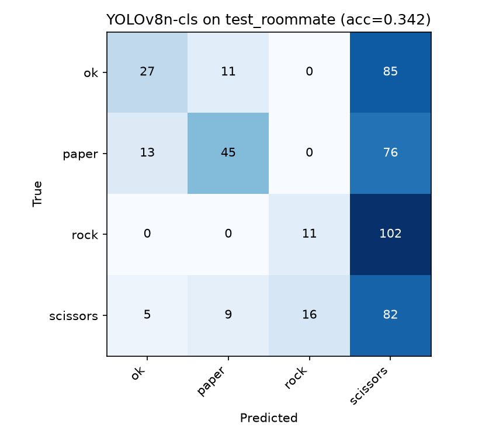
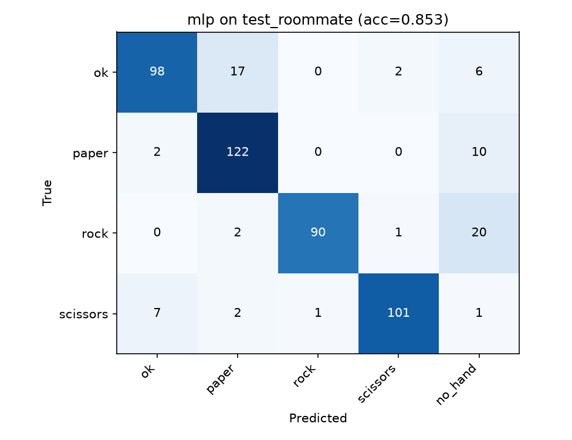
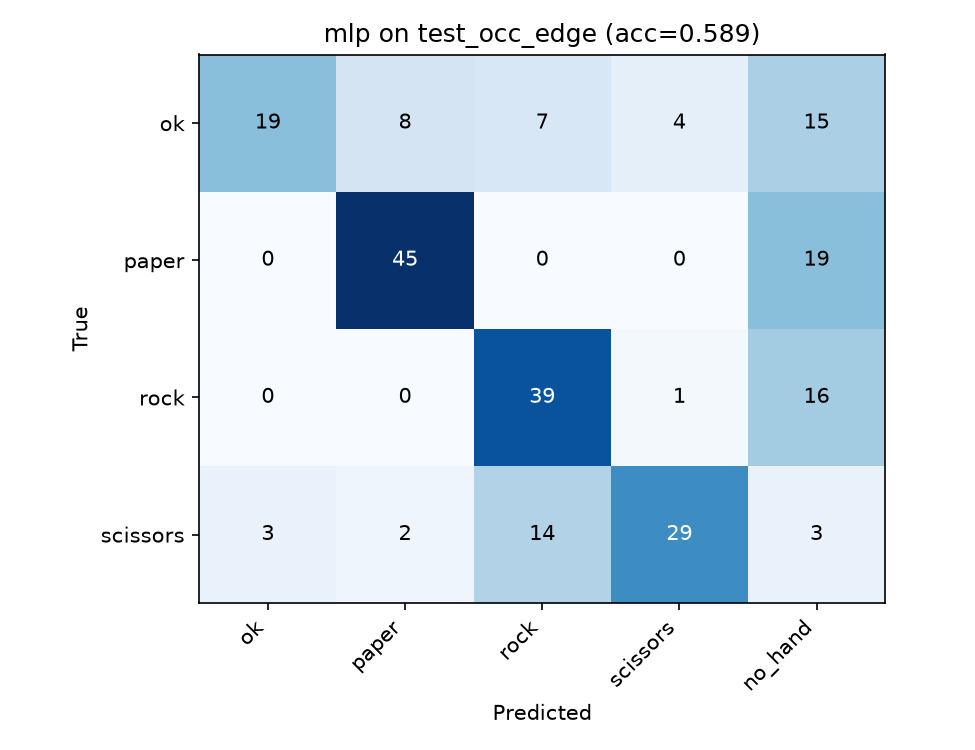
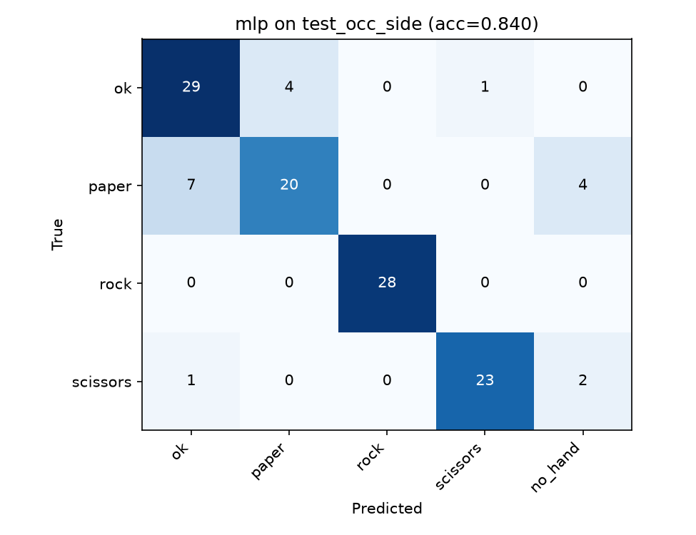

# 技術心得:從 0.37 到 0.84,我怎麼拆解「換人就變差」

> 草稿:以下是我依目前結果整理的版本,之後會再用自己的話改寫。

這個專案最大的收穫,不是把 val 準確率衝高,而是發現「val 高分」和「換人還能用」是兩件事。這篇除了結論,也記錄我怎麼拆程式碼、每張圖在看什麼,以及數字怎麼從預測 CSV 走到最後的判斷。

## 1. 先講結論

YOLO 在 val 約 0.68,換成室友的正常光只剩 0.37(三次種子 0.31 到 0.44);暗光 0.51、雜亂 0.43。把手的區域裁出來、置中放大後重新訓練,margin 0.3 的版本升到 0.55 / 0.62 / 0.73,但仍然落後方法 B。

方法 B 在原本三份室友測試集是 0.80 到 0.89;後來補拍的邊緣測試掉到 0.589,側面是 0.840。它的穩定度有上限,但整體還是比整張圖 YOLO 好。關鍵是:**沒偵測到手一律算錯**,而且我把「偵測失敗」和「分類錯誤」分開看。

## 2. 實驗設計與測試衛生

四類手勢是 `ok`、`paper`、`rock`、`scissors`。train/val 是作者的手;室友資料只評估,不訓練也不調參。

| 資料集 | 張數 | 條件                   |
|---|---:|----------------------|
| train | 2014 | 我的手,8 種背景            |
| val | 463 | 我的手,2 種 train 沒看過的背景 |
| test_roommate | 482 | 室友的手,正常光             |
| test_dark | 225 | 室友的手,暗光              |
| test_cluttered | 225 | 室友的手,雜亂背景            |
| test_occ_edge | 224 | 室友的手,正常光,手在畫面邊緣      |
| test_occ_side | 119 | 室友的手,正常光,手側面(角度未記錄)  |

幾個原則是先定下來的:

- **沒偵測到手算判錯**,這樣方法 B、裁切版 YOLO 和整張圖 YOLO 才能用同一個標準比較。
- 同時報「整體 acc」和「只看偵測到手的 acc」,才不會把偵測器的錯算到分類器頭上。
- 模型訓練完就凍結;方法 B 用 `--no_train`,`final_eval.py` 再用 `.test_evaluated` 防止重跑。
- edge/side 是看過原本結果才補拍的,屬於事後探索,不能當成事先規劃的對照實驗。

## 3. 程式碼管線:從照片到一張混淆矩陣

整個專案的資料流如下:

```text
data/<split>/<class>/*.jpg
  -> check_dataset.py
  -> extract_landmarks.py -> keypoints/<split>.npz
  -> keypoints_common.features -> train_keypoints.py
  -> pred_*.csv + cm_*.png
  -> summarize_predictions.py / failure_montage.py

data -> train_and_eval.py -> predictions_*.csv + confusion_matrix_*.png
data -> crop_experiment.py -> data_crop -> YOLO 重新訓練與評估
```

我寫程式的順序不是「先訓練模型」,而是先固定資料契約:

1. 先確定資料夾結構、`.npz` 欄位、預測 CSV 的欄位。
2. 先寫擷取與評估,讓每一張圖都有 `path`、`true`、`pred`、`detected`、`correct`。
3. 再寫模型;模型只是管線中的一格,不是整個專案。
4. 最後才寫 `summarize_predictions.py` 和 `failure_montage.py`,把 CSV 變成表格與圖。

每個階段都有可檢查的中間檔,出錯時不用從頭猜。

| 腳本 | 輸入 → 輸出 | 設計重點 |
|---|---|---|
| `extract_landmarks.py` | 影像 → `keypoints/<split>.npz` | MediaPipe 新舊 API、EXIF 轉正、長邊 1280、像素尺度;沒偵測到手存零矩陣與 `detected=False` |
| `keypoints_common.py` | 21 點 → 78 維特徵 | 手腕原點、landmark 9 尺度、63 座標 + 15 距離、左右翻轉 |
| `train_keypoints.py` | npz → RF/MLP、CM、預測 CSV | 排除沒偵測到的手;RF 300 棵樹;MLP + scaler、(64, 32)、early stopping;`--no_train` |
| `train_and_eval.py` | data → YOLO 權重、CM、預測 CSV | 訓練/評估分開;`--aug`;輸出 top-5 混淆與 confidence |
| `crop_experiment.py` | data → `data_crop`、`manifest.csv`、評估結果 | 手部外框裁正方形;manifest 記錄原始/成功張數;分母用原始張數 |
| `failure_montage.py` | 預測 CSV → 失敗案例拼貼 | 篩選 `wrong`/`nohand`、真實/預測類別;可畫骨架、裁手、模糊背景 |
| `summarize_predictions.py` | 預測 CSV → markdown 表格 | 整體 acc、`no_hand`、只看偵測到、各類召回率 |
| `final_eval.py` | 最終評估 → `results_test_summary.md` | 檢查張數;跑 YOLO 與方法 B;寫入 `.test_evaluated` |
| `scene_analysis.py` | 影像 + 預測 CSV → 分場景統計 | 背景顏色 KMeans、亮度分位數;探索性分析 |
| `live_demo.py` | 鏡頭 → 即時標籤 | 重用 `features()`;最近幾幀投票;可選 YOLO 對照 |

寫的過程中也有幾個實際踩到的坑:

- 類別資料夾拼錯(`sciccors`)或 `--data` 指到錯的資料夾,程式不會自動發現,結果看起來卻很合理。
- 相對路徑和 ultralytics 的 `runs/classify` 巢狀目錄,會讓權重路徑多一層。
- 失敗拼貼如果直接放原圖,會露出人臉;所以 `failure_montage.py` 提供 `--crop-hand` 和 `--blur-background`。

## 4. 三個關鍵設計

### 4.1 特徵工程:讓特徵不受位置與遠近影響

MediaPipe 給的是 21 個 `(x, y, z)`。直接丟進分類器會受手的位置與遠近影響,所以先以手腕為原點,再用「手腕到中指根部」的長度做尺度正規化:

```python
def normalize(lm):
    n = lm.astype(np.float64) - lm[0]
    scale = np.linalg.norm(n[9, :2])
    if scale < 1e-6:
        scale = 1.0
    return n / scale
```

`features()` 接著把 21 個點攤平成 63 維,再加上 5 個指尖到手腕的距離、10 個指尖兩兩之間的距離,總共 78 維。左右翻轉時只把 x 軸乘上 -1,讓模型同時看過左手與右手。訓練和 `live_demo.py` 共用同一個 `features()`,避免「訓練時一種特徵、demo 時另一種特徵」。

### 4.2 評估語意:`no_hand` 不是一個手勢類別

MediaPipe 沒偵測到手時,我不會把它當成第五類,而是存一個零矩陣和 `detected=False`。訓練時跳過這些樣本;評估時把它們的預測設成 `-1`,混淆矩陣多開最後一欄 `no_hand`:

```python
pred = np.full(len(y), -1)
idx = np.where(detected)[0]
if len(idx):
    pred[idx] = model.predict(np.array([features(lms[i]) for i in idx]))
acc_all = (pred == y).mean()
acc_det = (pred == y)[detected].mean()

cm = np.zeros((C, C + 1), dtype=int)
for t, p in zip(y, pred):
    cm[t, C if p < 0 else p] += 1
```

`acc_all` 把偵測失敗算錯,和 YOLO 的比較才公平;`acc_det` 只看偵測到手的樣本,用來判斷分類器本身好不好。`no_hand` 不是類別,而是「偵測階段失敗」的計數,所以放在最後一欄。

### 4.3 公平的分母與測試衛生

裁切版 YOLO 也一樣:沒偵測到手就沒辦法裁。只拿「裁切成功」的圖算準確率會高估方法,所以 `crop_experiment.py` 從 `manifest.csv` 讀回原始張數,分母用原始張數:

```python
n_total = sum(totals[(split, c)] for c in names)
acc_det = correct.mean()
acc_all = correct.sum() / n_total
```

另外,為了避免自己偷看 test 調參,`final_eval.py` 用一個標記檔擋住重跑:

```python
marker = BASE / ".test_evaluated"
if marker.exists() and not args.force:
    print(f"{marker} 已存在,代表 test_roommate 已經評估過。")
    return
```

方法 B 的 `--no_train` 也是同一個目的:模型凍結後,只載入 `rf.joblib` / `mlp.joblib` 去評估新資料集,不重新訓練。

## 5. 圖表導覽:每張圖在回答什麼

混淆矩陣的讀法是:**列是真實類別,欄是預測類別**,對角線是正確,`no_hand` 是最後一欄。標題的 `acc` 是整體準確率,已經把沒偵測到算錯。顏色深淺只在同一張圖內有意義,不同圖的色階不能直接比,要看格子裡的數字。

| 圖 | 類型 | 回答什麼 |
|---|---|---|
| [cm_yolo_exp2_roommate.png](figures/cm_yolo_exp2_roommate.png) | YOLO CM | YOLO 在室友正常光把大量樣本吸到 `scissors`(345/482) |
| [cm_mlp_roommate.png](figures/cm_mlp_roommate.png) | MLP CM | 71 個錯誤中 37 個是 `no_hand`;分類錯主要是 `ok`/`paper` |
| [montage_yolo_paper_ok.png](figures/montage_yolo_paper_ok.png) | 失敗拼貼 | YOLO 把張開的 `paper` 判成 `ok`;背景已模糊 |
| [montage_kp_ok.png](figures/montage_kp_ok.png) | 失敗拼貼 | MLP 把 `ok` 判成 `paper`;骨架大多正確,問題在特徵重疊 |
| [montage_nohand_rock.png](figures/montage_nohand_rock.png) | 失敗拼貼 | `rock` 完全沒偵測到手;握拳輪廓接近圓球 |
| [montage_crop_ok_scissors.png](figures/montage_crop_ok_scissors.png) | 失敗拼貼 | 裁切版 YOLO 把 `ok` 判成 `scissors`;室友的 `ok` 三指伸直 |
| [cm_mlp_occ_edge.png](figures/cm_mlp_occ_edge.png) | MLP CM | 邊緣測試 53 張 `no_hand`;`ok` 召回 0.358;`scissors` 14 張→`rock` |
| [cm_mlp_occ_side.png](figures/cm_mlp_occ_side.png) | MLP CM | 側面只有 6 張 `no_hand`;`paper` 7 張→`ok`、4 張沒偵測到 |









四張 CM 依序是 YOLO 正常光、MLP 正常光、MLP 邊緣、MLP 側面。montage 是隨機抽樣的質性案例,用來看不代表全部;拼貼圖都已裁手或模糊背景,沒有直接放原始人臉照片。

## 6. 數據分析:從 CSV 到判斷

我先定義幾個指標,後面所有數字都用同一套定義:

- `acc_all = 正確張數 / 全部張數`
- `acc_det = 偵測到且正確 / 偵測到張數`
- `recall_c = 類別 c 正確 / 類別 c 全部`
- `det_rate = 偵測到張數 / 全部張數`
- `no_hand = 全部張數 - 偵測到張數`

分析方法固定成五步:

1. 先看 `det_rate` 和 `no_hand`,判斷錯誤是偵測還是分類。
2. 看 `acc_all`/`acc_det` 的差距與各類召回率,避免整體準確率掩蓋某一類崩掉。
3. 看混淆矩陣的最大格子,找出主要混淆組合。
4. 分資料集比較,確認同一個現象是否只在一個條件成立。
5. 最後才比較模型,並用信賴區間提醒自己不要過度解讀。

| 資料集 | 偵測成功率 | MLP 整體 | MLP 只看偵測到 | 主要錯誤 |
|---|---:|---:|---:|---|
| test_roommate 正常光 | 92.3% | 0.853 | 0.924 | 71 錯:37 個 `no_hand`;`ok`→`paper` 17 張 |
| test_occ_edge | 76.3% | 0.589 | 0.772 | 53 張 `no_hand`;`ok` 15 張沒偵測到、19 張分類錯;`scissors` 14 張→`rock` |
| test_occ_side | 95.0% | 0.840 | 0.885 | 6 張 `no_hand`;`paper` 7 張→`ok`、4 張沒偵測到 |

RF 的整體 acc 是 0.817 / 0.549 / 0.782;side 的 `paper` 召回率 0.742 反而高於 MLP 的 0.645。MLP 整體較高不代表每類都較好;只有單次訓練,幾個百分點不能當定論。

YOLO 那邊,exp2 在室友正常光是 0.342,345/482 被判成 `scissors`;edge/side 是 0.375 / 0.479。裁切 margin 0.3 是 0.55,但仍有 76 張 `ok`→`scissors`,落後方法 B。這不是「YOLO 完全不行」,而是它沒有被逼著只靠手形分類。

`summarize_predictions.py` 把 `pred_*.csv` 轉成表格。方法 B 的欄位是 `path,true,pred,detected,correct`;YOLO 多一個 `confidence`。所有數字都從 CSV 算,不從圖片目測。`scene_analysis.py` 用外圈 8×8 顏色做 KMeans、再用亮度分位數分組;它適合找線索,但群集和手勢種類有重疊,只能當輔助。

edge 224 張,整體 acc 的 95% 信賴區間最壞約 ±6.5 個百分點;side 119 張約 ±9;每類樣本更少、區間更寬。幾個百分點內的差距是雜訊,而且沒有顯著性檢定,這裡的比較是描述性的。

## 7. 結果與解釋

YOLO 的錯誤不是單純「背景太雜」。margin 1.0 和 margin 0.3 的對照顯示,置中放大和去除背景都有幫助:雜亂集大約一半一半,暗光集幾乎來自置中放大,室友正常光兩段都有。所以不能把失敗全部推給背景;比較準確的說法是,它沒有被逼著只靠手形分類。

方法 B 的錯誤分成兩段:偵測和分類。正常光 MLP 的 71 個錯誤裡有 37 個是沒偵測到手,`rock` 最嚴重;有偵測到手時,主要是 `ok` 和 `paper` 互相混淆。邊緣測試讓兩段同時變大(偵測 76.3%、只看偵測到 0.772、`ok` 召回 0.358);側面則主要是 `paper`/`ok` 混淆(`paper` 0.645),偵測反而沒有明顯變差。這表示 2D 關鍵點不是無敵,手的位置和角度還是會影響。

## 8. 限制與下一步

這個專案的限制要說清楚:

- 只有一位室友的手,不能推廣到所有人。
- edge 沒有細分四邊、side 沒有細分角度,手被部分遮住的條件也還沒拍。
- 方法 B 只訓練一次,YOLO 各設定 1 到 3 次;沒有顯著性檢定,幾個百分點只能當雜訊。
- `check_dataset.py` 只查 train/val/test_roommate;`scene_analysis.py` 的分群和手勢重疊,只能當探索性證據。

下一步先補不同人的手形與背景,再改善 MediaPipe 偵測(例如暗光前處理),而不是先換更大的模型。要細分 edge/side,下次拍攝就分資料夾記錄四邊與角度。

## 9. 如果重來

如果重來一次,我會先做六件事:

1. 準備一份由另一個人拍攝、完全不碰的測試集。
2. 每個設定至少跑幾個種子。
3. 把「沒偵測到手」算進錯誤,並同時報 `acc_all` 與 `acc_det`。
4. 評估前先檢查資料夾、類別名稱和 `--data` 路徑。
5. edge/side 分資料夾記錄左/右/上/下與角度。
6. 用 `.test_evaluated` 之類的標記,防止自己重複看 test。

這次就遇到 `sciccors` 拼錯和 `--data` 指錯資料夾;結果看起來合理,其實完全無效。這些不是模型問題,是管線問題;先把管線顧好,後面的數字才有意義。

我不會說「YOLO 不行」。比較準確的說法是:在這個資料量和設定下,YOLO 沒有被迫學到手形,換人就露出問題;關鍵點方法把問題縮小到「偵測、手的位置/角度」和「少數手形」,但仍然不是萬靈丹。
